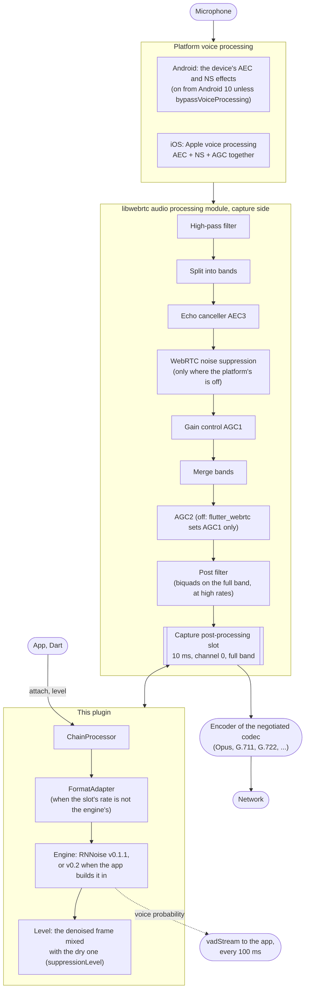

# flutter_webrtc_noise_suppression

A [flutter_webrtc](https://github.com/flutter-webrtc/flutter-webrtc) add-on: noise suppression of the voice an app sends. RNNoise runs in flutter_webrtc's capture post-processing slot, after the platform's echo cancellation and noise suppression and right before the encoder, with a suppression level and a voice activity stream. RNNoise v0.1.1 by default, v0.2 when the app builds it in. Android and iOS. Experimental. The plugin is built so that another engine joins it as a pull request: see [Adding an engine](docs/adding-an-engine.md).

## Architecture



The engine hears the voice after echo cancellation, the platform's noise suppression and gain control, and is the last thing that changes it before the encoder. That is the place an extra denoiser does not hurt echo cancellation; a hook before the processing module (raw microphone samples) would feed the echo canceller a signal it no longer recognizes. The codec sets the slot's rate: 48 kHz for Opus, 16 kHz for G.711 and G.722, where the format adapter takes RNNoise up to 48 kHz and back ([the capture path](docs/capture-path.md)).

| Layer | Where | Knows about |
|---|---|---|
| C core: `noise_suppressor.h` over RNNoise (48 kHz, 480-sample frames), engine chosen at creation (v0.1.1, or v0.2 when built in); the level's mix with the dry signal and the voice probability peak | `ios/flutter_webrtc_noise_suppression/Sources/NoiseSuppressionCore` (Android compiles the same files, `android/src/main/cpp`) | nothing |
| The suppressor's interface: `NoiseSuppressor` / `RnnoiseSuppressor` (Android, JNI), `NSPNoiseSuppressor` / `NSPRnnoiseSuppressor` (iOS) | `android/src/main/java`, `ios/.../Sources/NoiseSuppression` | the C core only |
| The add-on: `NoiseSuppressorRegistry` (name to engine), `FormatAdapter` (another rate or frame length), `WebrtcNoiseSuppressionPlugin` with its chain, which takes flutter_webrtc's captured frames and hands them to the engines | `android/src/main/kotlin`, `ios/.../Sources/flutter_webrtc_noise_suppression` | flutter_webrtc and the interface |
| Dart: `WebrtcNoiseSuppressionBridge` (`attach`, `setSuppressionLevel`, `vadStream`, `detach`, `measure`) | `lib/` | the channels |

The add-on works with the engines only through their interface and finds them by name, so another engine is another implementation of `NoiseSuppressor` with one registry line, and the add-on does not change. flutter_webrtc is reached through its public interfaces: `AudioProcessingAdapter.ExternalAudioFrameProcessing` on Android, `ExternalAudioProcessingDelegate` and `AudioManager.capturePostProcessingAdapter` on iOS. Nothing is looked up by name, and nothing goes into the app's `MainActivity` or `AppDelegate`: the plugin is registered by `GeneratedPluginRegistrant` like any other.

## Use

```yaml
dependencies:
  flutter_webrtc_noise_suppression:
    git:
      url: https://github.com/SERDUN/flutter_webrtc_noise_suppression.git
      ref: <commit>
```

```dart
const bridge = WebrtcNoiseSuppressionBridge();
await bridge.attach(); // true: RNNoise is in the slot; every call's microphone is denoised
await bridge.detach(); // true: it was there and is out
```

```dart
await bridge.setSuppressionLevel(0.5); // 1.0 fully denoised, 0.0 the voice as it reached the slot
bridge.vadStream.listen((p) => print('voice $p')); // 0.0..1.0, about ten a second
```

The level, the voice activity stream, what `attach` returns, the logs, `measure` and the diagnostics: [docs/usage.md](docs/usage.md).

## Documentation

| Document | What it covers |
|---|---|
| [docs/capture-path.md](docs/capture-path.md) | codecs and the slot rate, the processing before the slot, the platform effects measured on phones |
| [docs/wiring.md](docs/wiring.md) | from `attach()` to a frame in the slot and back out, step by step on both platforms |
| [docs/usage.md](docs/usage.md) | the level, `vadStream`, `attach` results, the log lines, `measure`, the slot input dump |
| [docs/engines.md](docs/engines.md) | RNNoise v0.1.1 and v0.2, their cost on phones, how v0.2 is built in |
| [docs/default-suppression.md](docs/default-suppression.md) | the phone's or WebRTC's own suppression against RNNoise, measured in calls |
| [docs/adding-an-engine.md](docs/adding-an-engine.md) | for contributors: what a pull request with a new engine adds |
| [docs/traps.md](docs/traps.md) | what behaved unexpectedly while building the plugin |
| [docs/checks.md](docs/checks.md) | the tests on the host, the JVM, a device and an iPhone |

## Requirements

`flutter_webrtc: ^1.6.3`. The capture slot, the Android controller's accessor and the SPM `WebRTC` product the plugin uses are flutter_webrtc's public API (checked at `v1.6.3`; the slot itself is there since `v1.0.0`).

## License

BSD 3-Clause, see [LICENSE](LICENSE). RNNoise is under its own BSD 3-Clause license: [THIRD_PARTY_NOTICES.md](THIRD_PARTY_NOTICES.md).
